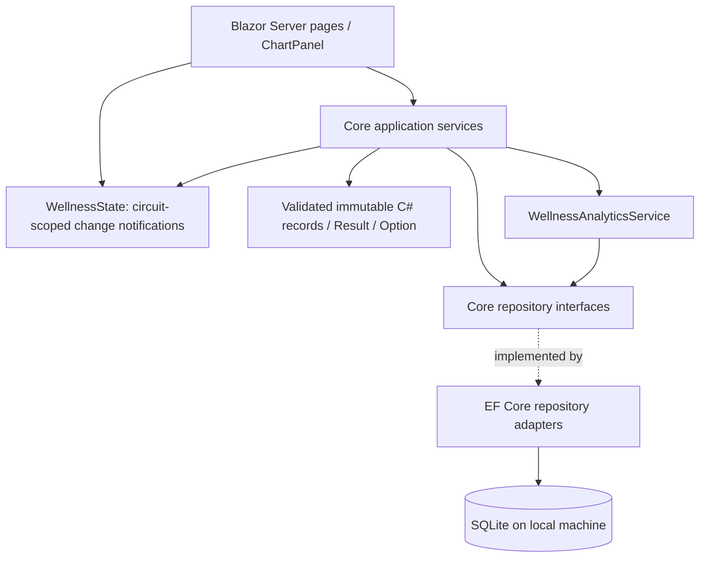
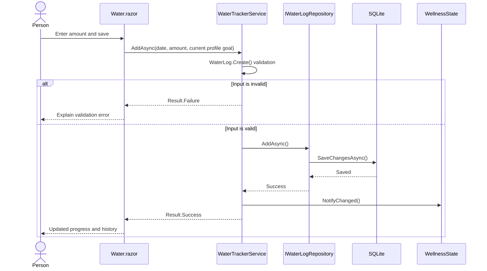

# MoodLog architecture and design decisions

## Scope

MoodLog is a **local single-user** interactive Blazor Server wellness journal. It tracks mood, water, sleep, and physical activity, builds date-based summaries, and exports CSV. It does not provide medical diagnosis or treatment, user authentication, shared profiles, cloud storage, or multi-tenant isolation. Do not expose it to the public Internet.

## Architectural overview

This is a **layered clean-architecture-inspired design**, not a strict MVC/MVVM implementation. The dependency direction keeps Core independent of the database and UI. Dependencies are registered in `MoodLog.Infrastructure/DependencyInjection.cs`.

## Separation of responsibilities

| Layer | Responsibilities | Main files |
| --- | --- | --- |
| `MoodLog.Core/Models` | Domain data and pure validation via `Create` methods | `MoodEntry`, `WaterLog`, `SleepLog`, `ActivityLog`, `ProfileSettings` |
| `MoodLog.Core/Functional` | Typed success/failure and optional-value functions | `Result`, `Option`, `DomainError`, `Unit` |
| `MoodLog.Core/Services` | Application workflows, validation before storage, analytics, change events | Tracker services, `WellnessAnalyticsService`, `WellnessState` |
| `MoodLog.Core/Interfaces` | Storage contracts | Five `I...Repository` interfaces |
| `MoodLog.Infrastructure/Data` | EF Core SQLite adapters, migrations, persistence | `MoodLogDbContext`, `Ef...Repository`, `DatabaseInitializer` |
| `MoodLog.Web` | Interactive UI, validation hints, feedback, accessible actions, CSV download | Pages, `ChartPanel`, CSS, JavaScript |

## Data flow: record a drink

## State and consistency

`WellnessState` is registered as a scoped service, so each Blazor Server circuit has a lightweight notification mechanism. After successful mutations, service methods publish a change event. Dashboard and Analytics subscribe, reload their data, and unsubscribe when disposed. Navigation also reloads data from the database. This is **not** cross-user or cross-server realtime sync.

The current profile's `DailyWaterGoalMl` is the canonical water target. Old records retain their original `DailyGoalMl` column for backward compatibility, but progress, analytics and CSV use the current profile target consistently. Changing the profile goal therefore changes how historic days are compared to the target (while preserving actual consumed amounts). The single-user profile ID remains `1`.

## Persistence / upgrades

EF Core SQLite migrations are located under `MoodLog.Infrastructure/Data/Migrations`, with the EF-generated `MoodLogDbContextModelSnapshot` alongside them for future model-change detection. `DatabaseInitializer` recognizes older pre-migration databases and records their baseline migrations before applying any missing migrations. CRUD operations reuse existing tables, so this revision **does not require a schema-breaking migration**. Preserve `moodlog.db` when updating; make a backup before upgrading on another computer.

## Why these technologies?

| Option | Strength | Tradeoff | Choice |
| --- | --- | --- | --- |
| ASP.NET Core Blazor Server | Full C# stack, interactive server UI, no browser C# payload | Needs a running server and connection | **Chosen** for a local academic application |
| Blazor WebAssembly | Runs client-side without continuous circuit | Bigger browser download and additional storage/API strategy | Not chosen |
| ASP.NET Core MVC | Familiar and stable server routing | More JS or page navigation for live widgets | Not chosen |
| EF Core + SQLite | Simple durable local storage, typed LINQ, migrations | Single file; limited heavy multi-user writes | **Chosen** |
| PostgreSQL | Strong concurrency and remote hosting support | Requires a managed/local database server | Not necessary for local scope |
| ChartPanel as CSS chart | No external JS chart dependency | Limited advanced interactions | **Chosen** |

## Scalability and performance considerations

- Date-range queries occur at repository level with EF Core and `AsNoTracking`.
- Indexes on dates assist retrieval; reports request at most 90 visible days plus 14 days for insights.
- Charts display only requested days and render as lightweight HTML/CSS.
- Each operation creates and disposes a short-lived EF Core context, avoiding long-running tracking contexts.
- SQLite is appropriate for the project's local single-user scope but is not a public multi-user architecture.
- No benchmark is claimed: CPU, memory, load tests and cross-device compatibility must be measured on real environments.

## UI and UX methodology

User journey: Dashboard → choose tracker → create/edit/delete entry → view updated history → Analytics (7/30 days) → optional CSV export. The UI uses semantic sections, labeled form inputs, inline validation, keyboard-focus outlines, responsive grids, deletion confirmation and disabled save buttons during pending mutations. Existing screenshots in `screenshots/` document the visual design before record-editing buttons were added; capture fresh screenshots from a running build for the final defense.
